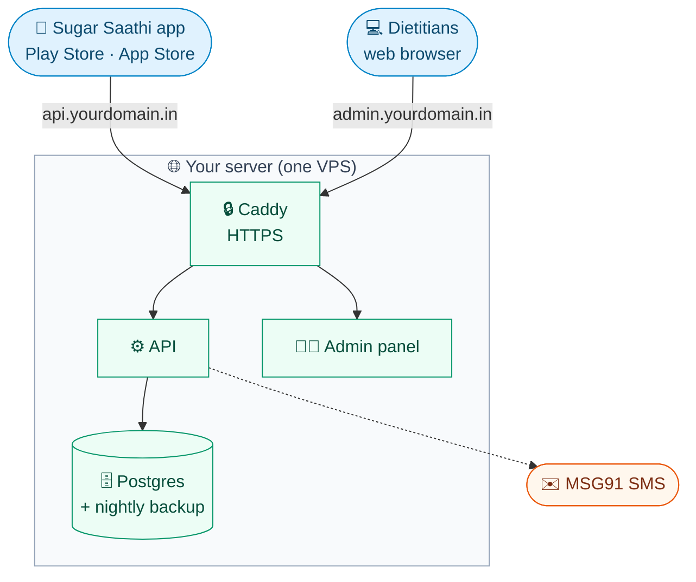

# 🚀 Publishing Sugar Saathi

**How to put the API and admin panel online, and publish the app on Google Play and the App Store, step by step.**

> [!IMPORTANT]
> Start **step 1 today**. The developer accounts, the company verification (D-U-N-S) and the SMS DLT registration each take **days to weeks**, and everything else waits on them.



---

## 🧰 Already prepared in the repo

| | File | What it does |
|:-:|---|---|
| 🐳 | `server/Dockerfile` | Production API image; runs database migrations on every start |
| 🐳 | `admin/Dockerfile`, `admin/nginx.conf` | Admin panel built once and served by nginx |
| 🌐 | `deploy/docker-compose.prod.yml` | Postgres, API, admin, Caddy (free HTTPS) and nightly backups on one server |
| 🔑 | `deploy/.env.production.example` | Every setting the server needs, with comments |
| 📲 | `eas.json` | App builds: `preview` (APK for testers) and `production` (store builds, version number goes up by itself) |
| 📄 | `admin/public/privacy.html`, `delete-account.html` | Privacy policy and account-deletion pages the stores ask for (**templates: fill in and get legal review**) |

**The API refuses to start in production if any of these are unsafe:**
- a weak `JWT_SECRET`;
- no `CORS_ORIGINS`;
- `OTP_MODE=dev`, which would let anyone sign in with a fixed code.

**It also has:**
- API docs (`/docs`) hidden in production;
- a per-IP limit on SMS codes, to stop SMS fraud;
- `npm run db:seed:production`, which loads only the real food catalog and one owner login (no demo patients).

---

## 📋 1. Accounts and paperwork (start first)

| | What | Cost | Time |
|:-:|---|---|---|
| 🏢 | **Company + D-U-N-S number** (free, from Dun & Bradstreet) | Free | 1–2 weeks |
| 🤖 | **Google Play Console**, as an **organization** | $25 once | 2–7 days to verify |
| 🍎 | **Apple Developer Program**, as an **organization** | $99 / year | 2–7 days |
| ✉️ | **MSG91** account and **DLT registration** (entity, sender ID, OTP template) | Pay per SMS | 3–10 days |
| 🌐 | **Domain** (e.g. `yourdomain.in`) | ~₹800 / year | Same day |
| 🖥️ | **VPS in Mumbai** (2 vCPU, 4 GB RAM) | ~₹1,500–3,000 / month | Same day |
| 📦 | **Expo account** (expo.dev) for EAS builds | Free tier is enough to start | Same day |

- **Use organization accounts, not personal ones.**
  - New personal Google Play accounts must run a closed test with at least 12 testers for 14 days before they can publish.
  - Health apps are also safer under a company name on both stores.
- **DLT:** Indian law (TRAI) blocks SMS from senders that aren't registered. MSG91 guides you through registering on a DLT portal (Jio, Vi, Airtel…). Register an **OTP template** such as `{#var#} is your Sugar Saathi code. Do not share it.` and keep its **template ID**.
- **Optional:** a Sentry account for crash reports (free tier).

---

## 🔐 2. Legal and content (in parallel)

1. **Fill in the policy pages.** Replace every `[BRACKET]` in `admin/public/privacy.html` and `admin/public/delete-account.html`: company name, grievance officer, support email, hosting provider and location.
2. **Have a lawyer review them** against India's DPDP Act 2023. The app already asks for consent and lets people download and delete their data.
3. **Get the health content checked.** Have a doctor check the sugar ranges and emergency steps (`src/logic/sugar.ts`, emergency screen), and dietitians verify the draft foods (admin → Foods → Review queue).
4. **Prepare the store listing:** app name, short and long description (English and Hindi), 4–8 phone screenshots, a 512×512 icon, and a 1024×500 feature graphic (Play only).

> [!WARNING]
> Never say the app diagnoses, treats or prescribes. Both stores (and CDSCO in India) treat that as a medical device. Keep to "helps you track habits and work with your dietitian".

---

## 🌐 3. Put the API and admin panel online

**3.1 Point the domain at the server.** In your domain's DNS, add two **A records** pointing to the VPS's public IP: `api` and `admin`.

**3.2 Install Docker on the server** (Ubuntu 24.04):

```sh
curl -fsSL https://get.docker.com | sh
sudo usermod -aG docker $USER   # log out and back in
```

**3.3 Copy the code to the server:**

```sh
git clone <your-repo-url> glucobuddy && cd glucobuddy
```

**3.4 Fill in the settings.** Copy the template, then set every value. Make each secret with `openssl rand -hex 32`.

```sh
cp deploy/.env.production.example deploy/.env
nano deploy/.env
```

**3.5 Start everything.** The first build takes a few minutes, and Caddy gets HTTPS certificates by itself.

```sh
docker compose -f deploy/docker-compose.prod.yml --env-file deploy/.env up -d --build
```

**3.6 Load the food catalog and the first owner login** (once):

```sh
docker compose -f deploy/docker-compose.prod.yml --env-file deploy/.env exec api npm run db:seed:production
```

**3.7 Sign in and set up staff.**
1. Open `https://admin.yourdomain.in` and sign in with `OWNER_EMAIL` / `OWNER_PASSWORD`.
2. Add dietitians under **Staff**.
3. Verify foods in the **Review queue**.
4. Remove `OWNER_PASSWORD` from `deploy/.env`. It is used only once.

**3.8 Back up off the server.** Dumps land in `deploy/backups/` every night at 02:30 IST and are kept for 14 days. Copy them somewhere else daily too, for example to S3 or Google Drive with `rclone`.

> [!CAUTION]
> Keep `deploy/.env` private and never commit it. It holds the database password, the login signing key and the SMS key.

---

## 📲 4. Prepare the app

**4.1 Log in to Expo and link the project.** `eas init` adds the project id to `app.json`; commit that change.

```sh
npm install --global eas-cli
eas login
eas init
```

**4.2 Tell the app where the API is.** These values are built into the app, and anyone can read them, so never put secrets here:

```sh
eas env:set --name EXPO_PUBLIC_API_URL --value https://api.yourdomain.in --environment production --visibility plaintext
eas env:set --name EXPO_PUBLIC_API_URL --value https://api.yourdomain.in --environment preview --visibility plaintext
eas env:set --name EXPO_PUBLIC_SENTRY_DSN --value <dsn> --environment production --visibility plaintext   # optional
```

**4.3 Set up push notifications.**
- **Android:** create a Firebase project, download its service-account key (FCM v1), then upload it with `eas credentials --platform android`.
- **iOS:** EAS creates the push key when you build (step 6).
- **Server:** put your Expo access token in `EXPO_ACCESS_TOKEN` in `deploy/.env` so the server can send pushes.

**4.4 Check the look.** Make sure `assets/images/icon.png`, the Android adaptive icons and the splash image are the final Sugar Saathi artwork, not placeholders.

**4.5 Test on real phones first.** Build an APK and install it on 5–10 phones, including older Android ones and Hindi users:

```sh
eas build --platform android --profile preview
```

> [!TIP]
> Put one **reviewer test number** in `REVIEWER_PHONES` (for example `+919999900001`). It signs in with code `123456` without an SMS. Give it to Apple and Google in the review notes, because reviewers can't receive Indian SMS.

---

## 🤖 5. Publish on Google Play

1. **Create the app** in Play Console: name Sugar Saathi, default language Hindi or English, App, Free.
2. **Complete "App content":**
   - privacy policy URL `https://admin.yourdomain.in/privacy.html`;
   - **Data safety**: phone number, health info, app activity, crash logs, all encrypted in transit, deletion possible;
   - account deletion URL `https://admin.yourdomain.in/delete-account.html`;
   - **Health apps** declaration;
   - content rating;
   - target audience 18+.
3. **Give Google API access.** Create a service account in Google Cloud, invite it in Play Console (**Users and permissions**), then add its key to EAS with `eas credentials --platform android`.
4. **Build and send it to the internal test track:**

   ```sh
   eas build --platform android --profile production
   eas submit --platform android --profile production
   ```

5. **Test on the internal track** with your team. Then promote it to **closed testing**, then **production** (this needs the 12-tester, 14-day test if the account is personal). Start the rollout at 20%, then go to 100%.

---

## 🍎 6. Publish on the App Store

1. **Create the app** in App Store Connect with bundle id `com.sugarsaathi.app` (from `app.json`).
2. **Fill in App Privacy** (same data as Google's Data safety), age rating, category **Health & Fitness**, privacy policy URL and support URL.
3. **Build and upload.** EAS asks for your Apple login once and creates the certificates:

   ```sh
   eas build --platform ios --profile production
   eas submit --platform ios --profile production
   ```

4. **Test it in TestFlight** with your team.
5. **Submit for review.** In the review notes, give the reviewer test number and code `123456`, and say: "Not a medical device; habit tracking with a human dietitian."

> [!NOTE]
> Payments are recorded by staff (UPI / cash), and the app has no buy button. Apple allows outside payment for one-to-one services with a real person, such as dietitian consultations. If you later sell app features inside the app, Apple requires In-App Purchase.

---

## 🔄 7. Releasing updates later

| | Change | How |
|:-:|---|---|
| ⚙️ | API or admin panel | On the server: `git pull`, then the `up -d --build` command from step 3.5. Migrations run on start |
| 📲 | App | Raise `version` in `app.json` (e.g. 1.0.1), then repeat the build and submit commands. Build numbers go up on their own |
| 🗄️ | Database schema | Create a migration locally (`npx prisma migrate dev`), commit, deploy. Never edit the production database by hand |

- Release the **server first**, then the app, so new app versions never call an API that isn't there yet.
- Over-the-air updates (`eas update`) can come later: they need `expo-updates` installed and a new store build.

---

## 🧪 Check it worked

- [ ] `https://api.yourdomain.in/docs` returns **404** (docs hidden) and the admin panel loads over HTTPS
- [ ] A real phone gets the **SMS code** and signs in; the reviewer number signs in with `123456`
- [ ] A new patient gets the 14-day plan; the dietitian sees them in admin
- [ ] A push notification from admin arrives on Android and iPhone
- [ ] Hindi users see Hindi everywhere (plan titles, notices, offer)
- [ ] Tomorrow morning a backup file appears in `deploy/backups/`
- [ ] Settings → **Delete my account** works and the patient disappears from admin

<details>
<summary><b>🔧 Troubleshooting</b></summary>

<br>

| Symptom | Check |
|---|---|
| API keeps restarting with "Unsafe production settings" | The message lists what to fix in `deploy/.env` |
| No HTTPS / certificate errors | DNS A records point at this server; ports 80 and 443 are open in the firewall |
| No SMS arrives | MSG91 dashboard → logs; the DLT template ID matches `MSG91_TEMPLATE_ID` exactly |
| "too_many_requests" on sign-in | 5 codes per number per hour, 30 per IP per 10 minutes (raise with `OTP_IP_LIMIT`) |
| App can't reach the server | `EXPO_PUBLIC_API_URL` was set before the build; rebuild after changing it |
| Building on a laptop behind Zscaler fails | Add `--secret id=ca,src=certs/extra-ca.pem` to `docker build` (see the Dockerfiles) |

</details>
